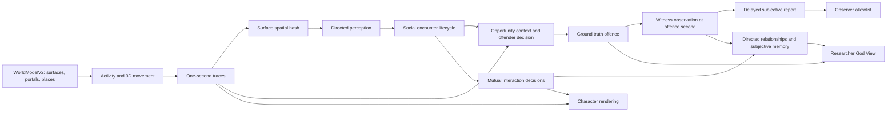

# v0.6.1 Encounter and social world architecture

## Code audit and compatibility boundary

This workstream extends the existing 300 m `WorldModelV2` derived from `shadow-city-hero-01`. It does not replace the city, navigation graph, character assets, or legacy simulation. `SimulationStateV5` already owns integer-millimetre positions, `surfaceId`, fixed six-second ticks, deterministic activity slots, access commands, offence hazard episodes, truth offences, and delayed reports. `movementV5.ts` supplies one-second positions. `engineV5.ts` currently calls `updateOpportunityV5` after movement. `EncounterEpisodeV5` in `v5Types.ts` means a **crime hazard episode**, not a social encounter. There is no social state, subjective witness memory, or relationship model in the existing v5 path.

The existing offence code samples same-surface contact and a keyed episode threshold. It directly creates a truth offence when hazard crosses that threshold. Its reported `second` is the end of the Tick, and its contact filter uses end-of-Tick activity. The new mode must use the actual one-second trace, an explicit decision stage, and witness information captured at the offence second. Legacy mode remains byte-for-byte deterministic for the old config and replay fingerprint. A new optional, versioned social configuration selects the new pipeline; it is included in the experiment fingerprint. Running an old checkpoint under the new config must fail fingerprint validation. Legacy v2–v4 engines remain separate.

## Authority and tick pipeline

Commands and access changes apply first. Activity choice and movement produce a complete position sample for each citizen at seconds 1–6, including a citizen blocked mid-Tick; the prior state is the second-0 position. Candidate pairs are queried by surface-keyed horizontal grid and checked using three-dimensional distance, blocked polygons, and explicit portals, with stable unordered pair keys. Spatial proximity, potentially visible, actually perceived, socially recognized, and identity known remain separate facts. Encounter state is updated after perception. Crime and witness evaluation use the current Tick's contact and perception but **prior-Tick** social knowledge/relationships, so a name learned at the end of the Tick cannot reach an earlier witness sample. Social interaction and memory updates happen after crime evaluation. An episode can have one initial greeting/no decision and, if both later stop at legal slots for at least two contact seconds, one separate conversation decision. A stationary conversation accepted by **both** participants locks the residents at their current legal slots from the next Tick and delays the next activity decision. Thus no interaction changes movement earlier in the same Tick. Closure of a place interrupts the lock before evacuation. Memory and relationship changes become available to decisions on the next Tick, avoiding causal cycles.

The encounter-aware crime mode consumes eligible second-level contact and the current social context. An opportunity is not an attempt; a keyed offender decision/hazard determines whether an attempt produces one truth offence. Offence position, surface, and second come from the threshold-crossing sample. Witness candidates are evaluated against that same sample, then independent attention, recognition, identity belief, report willingness, and delivery delay are applied. Neither nearby presence nor witness recognition grants police knowledge. The observer read model projects only delivered report fields through an explicit allowlist. Researcher God View joins private identity mapping and truth without changing that observer boundary.

## Model semantics and assumptions

- **Co-presence:** legal three-dimensional proximity on the same walkable surface, or a physically adjacent open portal/connector. Different floors with the same X/Z are separate. Blocked polygons and semantic surfaces are authoritative; visual `WorldBox` meshes are not a collision model.
- **Visibility:** a documented surface/blocked-polygon and facing approximation. It is not a complete line-of-sight or human-vision model. `potentiallyVisible` can be true while `actuallyPerceived` is false.
- **Social encounter:** a candidate pair survives a minimum contact duration and at least one directed perception. Enter/exit thresholds and cooldown prevent oscillating boundaries from emitting repeated starts. Active, completed, and transient candidate storage are separate. Episode IDs derive from canonical pair and start time.
- **Interaction:** greeting is brief; conversation requires two consecutive stationary contact seconds at legal public slots, available time, and bilateral willingness. A pair can decline both keyed stages; neither stage is rerolled every Tick. Accepted conversation occupies 2–5 six-second Ticks in the default synthetic model. Shared activity and service are deferred until their time, capacity, and information-exchange semantics are specified; they are not cosmetic labels.
- **Relationship:** directed familiarity, recognition, and trust are continuous synthetic state, with categories derived for display. Repeated passing may increase weak familiarity but cannot by itself create friendship or known identity. Appearance and outfit never feed crime propensity, trust, or suspicion.
- **Knowledge and memory:** the owner sees an opaque local recognition token. Private referent-to-agent mapping is retained only for simulation joins and God View. A visual encounter does not reveal name or Agent ID. A completed conversation can independently exchange each participant's synthetic name, creating a directional `identityBelief`. Witness name claims require separate visual and identity knowledge with sufficient confidence. Memory has source, confidence, salience, Tick, and a strict per-owner capacity; decay and forgetting do not rewrite truth history. Hearsay requires a real exchange event; no global knowledge broadcast.
- **Crime:** the old offence hazard is preserved only for legacy mode. New opportunity, offender attempt, completed offence, victim/witness observation, and report are different countable stages. Hazard is normalized by exposure seconds and consumes at most one offence per episode, with deterministic cooldown. No place type directly triggers crime.
- **Experience feedback:** relationship state affects future interaction willingness. A witnessed or victim experience can record a bounded, subjective place-risk score if the resident recalls the place. Route and destination feedback is deferred until it can be incorporated into the existing utility model without an implicit global truth signal.

| Synthetic parameter | Default | Interpretation |
| --- | --- | --- |
| Encounter enter / exit | 2.4 m / 3.2 m | Spatial contact with exit hysteresis; minimum contact 2 s, exit grace 12 s, cooldown 12 s. |
| Perception | 220° field, moving attention 0.52, stationary attention 0.82 | Directional attention approximation, multiplied by an independent personal attention trait. |
| Greeting / conversation willingness | 0.38 / 0.24 in the library; 0.70 / 0.85 in the explicit research UI scenario | Bilateral keyed acceptance is further scaled by independent sociability and patience. Neither outcome is guaranteed. |
| Conversation duration | 2–5 Ticks | Fixed-time stationary lock; no animation-driven displacement. |
| Name exchange | 0.55 per speaker after completed conversation | A received name is a claim in owner-local knowledge, not an automatic truth-to-observer link. |
| Witness identity confidence | 0.60 | A lower-confidence recognition may remain visual only and does not become a named report claim. |
| Memory / knowledge capacity | 24 / 32 per resident | Salience/recency pruning; memory confidence half-life 1,200 Ticks. |
| Diagnostic decision trace | Off in library; on in research UI, last 512 records retained | Captures the chance and keyed draw actually used for each participant, sociability, familiarity, available time, stationary eligibility, contact, and directed perception. `null` chance/draw means no trial. Configurable capacity changes diagnostics only. |
| Social restraint | 0.12 | If an offender has actually perceived a known target, directed familiarity raises perceived risk in the existing offender decision model. |
| Offence completion | 0.82 | An attempt can fail without creating a truth offence. |

All sociability, attention, recognition, memory, trust, risk, and offender parameters are synthetic assumptions. This model does not predict human friendship, testimony reliability, or real-world crime. Social ties are not crime networks. No ordinary scenario specifies a required meeting, friendship, offence, witness, or report. Keyed random choices use seed, resident or pair, episode, Tick/second, and decision type; rendering order, camera, FPS, wall-clock time, and `Math.random()` do not participate.

## Phases and independent exit gates

| Phase | Deliverable | Exit gate |
| --- | --- | --- |
| A | Spatial hash, legal contact, stable pair keys, lifecycle events | Same-X/Z cross-floor and blocked geometry tests; portal and connector tests; high-density duplicate checks; replay-stable IDs. |
| B | Directed perception and bilateral greeting/conversation | Near does not imply perception or interaction; no moving conversation; two-party acceptance and Tick cost; no teleport; deterministic reset. |
| C | Bounded subjective memory and directed relationships | Provenance and unknown-person tokens preserved; asymmetric knowledge; no automatic friendship; Tick 100/500 replay parity; growth bound. |
| D | Exclusive encounter-aware crime mode, offence-second witness and reporting | Zero opportunity yields zero offence; encounter does not guarantee crime; no cross-floor witness; subjective report allowlist; observation-only truth independence; legacy regression. |
| E | Researcher Relationship/Encounter/Memory/Timeline inspection and scene highlighting | UI reads real state; history seeks the actual Tick; character position comes from simulation; God View works in all event modes; browser screenshots reviewed. |
| F | Scenarios, metrics, performance, science and visual record | Positive naturally occurring chain and negative zero-event fixture; metric denominators stated; 100–200 population measurements and hardware Chrome evidence; typecheck, tests, build. |

## Verification and metric definitions

Use fixed city seed `shadow-city-hero-01` and record simulation/social/offending/observation seeds, commands, Tick, 1440×900 CSS viewport, DPR, browser, renderer, and screenshot filename. Inspect hero, public space, selected resident, active and past encounter, relationship and memory tabs, start/end of an interaction, Tick 100/500 replay, cardinal bearings, and narrow viewport. A screenshot gate remains open if browser access or a natural interaction sample is unavailable. Do not infer hardware GPU performance from SwiftShader.

`summarizeSocialMetricsV1(endState, config, priorBoundaryState?)` derives a reproducible report without changing simulation state. Without a boundary it covers Ticks 0–`end.tick`; with one it covers `(prior.tick, end.tick]`. The two states must have the same fingerprint. Every report states that inclusive Tick range, population, simulation/social seeds, and scenario. A count of pair-seconds is never labelled a count of distinct people or pairs.

| Metric | Exact unit and interval rule | Denominator or limit |
| --- | --- | --- |
| Candidate and perceived exposure | Delta of cumulative canonical unordered **pair-second** counters; perceived means at least one directed perception in that second | Perceived fraction uses candidate pair-seconds. Distinct candidate pairs are not retained. |
| Encounter episodes / unique pairs | Episodes whose `startedTick` is in range; unique canonical pair keys among that cohort | Episode count may exceed unique pair count. Pair share may use `N × (N - 1) / 2`. |
| Duration distribution | `contactSeconds` of episodes started in range and ended by the end state, grouped by exact seconds | Active episodes are separately right-censored; do not include incomplete durations. |
| Contacts, place, hour | Per-agent distinct counterpart count; episode count by **last recorded** `placeId`; episode count by local start hour computed from `startHour` and six-second Ticks | Place is a terminal episode attribute, not proven starting location. Hour buckets are 00–23. |
| Repeated pairs | Number of pair keys with at least two episodes started in range, plus additional episodes beyond each pair's first | Divide repeated-pair count by unique encounter pairs only when that question is intended. |
| Decision, attempt, acceptance | Initial/settled decision records by decision Tick; `Attempted` events by event Tick; materialized interactions by decision Tick | An evaluated phase need not create an attempt; a one-sided request can be rejected. |
| Completion and duration | Interactions with `status=completed` and `endTick` in range; completion duration is `plannedEndTick - startTick` Ticks, greeting zero | Completion and acceptance are different time cohorts; avoid a raw completion/acceptance fraction for short windows. |
| Directed network | End-Tick relation states, familiar ties at familiarity ≥0.25, known contacts with ≥2 completed conversations and familiarity ≥0.4; new familiar ties cross 0.25 relative to the prior boundary | Directed known-contact density uses `N × (N - 1)` possible ordered ties; null for `N<2`. A known social contact need not know a name. |
| Familiarity distribution | End-Tick histogram over **all possible ordered resident pairs**; absent relation is zero | Weak/familiar/strong bins are display thresholds, not validated social categories. |
| Perception and memory | Episode count with ≥1 or both `perceivedBy`; distinct current owner-local visual-recognition tokens; retained bounded memory and knowledge records | Current retained knowledge is not lifetime recognition incidence. |
| Identification | Each actual `WitnessObservation` acquired in range: no nonempty believed name = unknown; believed synthetic display name equal to truth offender's synthetic display name = correct; other name = incorrect | Observation records, including victims, are the denominator. “Correct” is a name-string match, not a uniquely verified real identity. |
| Opportunity and offence | Delta of eligible offender-target/resource exposure-seconds; truth `OffenceV5` by occurrence Tick; incidence shown as offences per 1,000 opportunity-seconds | Full opportunity episode history is overwritten by key, so an episode-to-offence conversion fraction is **unavailable (`null`)**, never fabricated. |
| Attempts and citizen targets | Delta of keyed offender attempt counter; truth offences with citizen targets | Attempts are distinct from completed offences; a citizen target is identifiable to God View, not necessarily to a witness. |
| Witnessed / unwitnessed | A truth offence is witnessed if ≥1 `source='witness'` observation links to it; victim observations are separate | Truth offences in range are the denominator. Potential witness assessments require `potentiallyAbleToObserve=true` and are a separate count. |
| Reported / unreported | A truth offence is reported only if a `reportLink` joins to a report already delivered by the end Tick | Scheduled or pending reports do not count. Several delivered reports may refer to one offence. |
| Spatial truth distribution | Truth offences by occurrence `placeId`; encounters by last recorded `placeId` as above | Null place remains an explicit bucket. |

The summary uses cumulative counter deltas only where the state actually retains a counter; arrays supply cohort and current-state distributions. It does not equate an episode with a unique pair, opportunity exposure with an attempt, potential witness with actual observer, or delivered report with a truth offence. `EncounterDecisionTraceV1` records the actual keyed chance and draw computed in the decision function, along with each resident's sociability, current directed familiarity, available Ticks, and stationary eligibility; the inspector never reconstructs these inputs afterward. Traces exist only when enabled and retain at most `diagnosticTraceCapacity` latest records (512 by default), so an older decision may have no surviving trace. This limit does not change the underlying decision or replay. Per-owner memory, knowledge and perceived-place-risk state are bounded. Historical event/episode arrays remain append-only in this in-memory research model, so long-run storage growth must be measured and is not claimed bounded.

Run focused tests for legal surfaces and connectors, no forced outcomes, pause/step/speed independence, memory bounds, old v5 and v2–v4 replay, fingerprint mismatches, reporting-only truth invariance, and long-run deterministic checkpoints. Measure spatial query, encounter, interaction, memory, total Tick, Tick 500 replay, state/history growth, frame intervals, draw calls, and triangles at 100 and 200 residents. A visual or performance claim is made only after the named browser and GPU were actually used.
